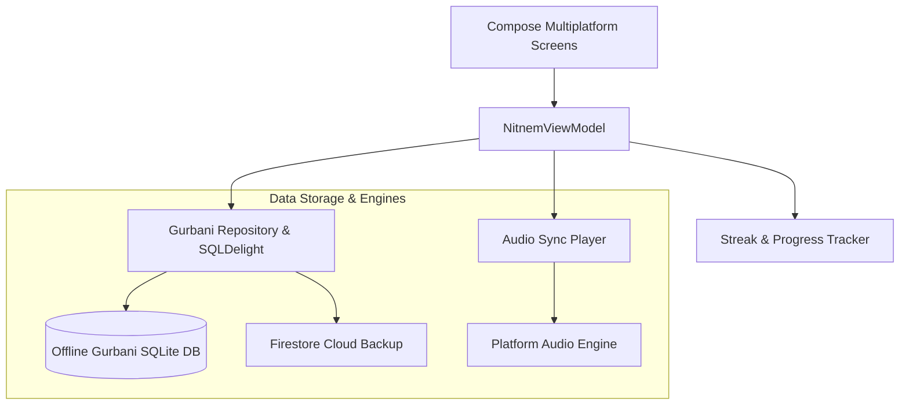

# ੴ ਨਿਤਨੇਮ ਗੁਟਕਾ ਸਟੀਕ (Nitnem Gutka Steek)

<p align="center">
  
</p>


[](https://kotlinlang.org/)
[](https://www.jetbrains.com/lp/compose-multiplatform/)
[](#)
[](https://developer.android.com/)
[](#)

> **ਨਿਤਨੇਮ ਗੁਟਕਾ ਸਟੀਕ (Nitnem Gutka Steek)** is a sacred, multiplatform spiritual reading and learning companion. Developed using **Compose Multiplatform (KMP)**, it delivers authentic, line-by-line Gurbani recitation with Gurmukhi, English transliterations, Hindi scripts, audio synchronization, grammatical analysis (Viakaran), and complete Steek (exegesis/meanings).

---

## 📑 Table of Contents
1. [Overview & Spiritual Mission](#-overview--spiritual-mission)
2. [Complete Bani Catalog](#-complete-bani-catalog)
3. [Key Features & User Experience](#-key-features--user-experience)
4. [System Architecture](#-system-architecture)
5. [File & Directory Structure](#-file--directory-structure)
6. [Tech Stack & Dependencies](#-tech-stack--dependencies)
7. [Installation & Getting Started](#-installation--getting-started)

---

## 🌟 Overview & Spiritual Mission

- **Line-by-Line Steek**: Complete English translations, Punjabi teeka (meanings), and word-by-word Viakaran breakdown.
- **True Multiplatform**: Seamless reading experience across **Android**, **iOS**, **Desktop (macOS / Windows / Linux)**, and **Web**.
- **Offline First**: Bundled offline Gurbani database ensuring instant access anywhere without requiring an active internet connection.
- **Spiritual Habit Building**: Daily Nitnem reminder schedules, reading streak tracking, and customizable Gurmukhi typography.

---

## 📖 Complete Bani Catalog

The application covers the full sacred Nitnem regimen and extended liturgical banis:
- **Amritvela**: Japji Sahib, Jaap Sahib, Tav-Prasad Savaiye, Chaupai Sahib, Anand Sahib
- **Evening**: Rehras Sahib, Aarti
- **Night / Kirtan**: Kirtan Sohila
- **Extended Baanis**: Sukhmani Sahib, Asa Di Vaar, Dukh Bhanjani Sahib, Bawan Akhree, Sidh Gosht, Shabad Hazare, Barah Maha

---

## 🚀 Key Features & User Experience

### 📜 Sacred Reader & Typography
- **Multi-Script Display**: Gurmukhi, Roman Transliteration, English Translation, and Hindi Devnagari script.
- **Customizable Gurmukhi Typefaces**: Support for GurbaniAkhar, AnmolLipi, and standard Unicode fonts with adjustable font sizing and line spacing.
- **Gurbani Line Card (`GurbaniLineCard.kt`)**: Interactive line focus with audio recitation highlights, bookmarking, and instant shareable verse cards.

### 🔍 Advanced Gurbani Search (`AdvancedGurbaniSearchModal.kt`)
- **First-Letter Search (Shabad Khoj)**: Instant query matching by the first letters of Gurmukhi words (e.g., `ਗਗਨਮ` for *Gagan Mai Thaal*).
- **Phonetic & Roman Search**: Find verses even without a native Gurmukhi keyboard.

### 🎙 Synchronized Audio Player
- **Voice Recitations**: Synchronized audio playback with auto-scrolling verse tracking.
- **Playback Controls**: Variable playback speed (0.75x to 1.5x), sleep timer, and background playback service.

### 📈 Daily Habit Tracker & Streaks (`WeeklyStreakDialog.kt`)
- **Nitnem Consistency Engine**: Tracks Amritvela, Evening, and Night recital completion.
- **Weekly & Monthly Streaks**: Visual streak calendars encouraging daily meditation (Simran) and devotional discipline.

---

## 🏛 System Architecture

The project follows the **Clean MVI Architecture** with reactive state management:



---

## 📂 File & Directory Structure

```text
NitnemGuktaSteek/
├── build.gradle.kts                      # Root Gradle configuration
├── settings.gradle.kts                   # Subproject definitions
├── composeApp/
│   ├── build.gradle.kts                  # Multiplatform build targets
│   └── src/
│       ├── commonMain/
│       │   ├── kotlin/com/creativeblisslabs/nitnemguktasteek/
│       │   │   ├── app/ui/screens/       # HomeScreen, GurbaniExperienceScreen, SettingsScreen
│       │   │   ├── app/ui/components/    # GurbaniLineCard, MeaningSheet, StreakDialog
│       │   │   ├── app/ui/theme/         # Sacred golden color palette, fonts, typography
│       │   │   └── viewmodel/            # NitnemViewModel & state controllers
│       │   └── composeResources/         # Gurmukhi fonts, icons, bundled banis
│       ├── androidMain/                  # Android audio services & widget providers
│       ├── desktopMain/                  # Desktop JVM window controls
│       └── iosMain/                      # iOS Swift/Compose integration
└── shared/                               # Shared data layer & database drivers
```

---

## 🛠 Tech Stack & Dependencies

| Technology | Purpose |
|---|---|
| **Kotlin Multiplatform (KMP)** | Single shared codebase for Android, iOS, Desktop |
| **Compose Multiplatform** | Modern declarative UI with fluid spiritual aesthetics |
| **Kotlinx Coroutines & Flow** | Real-time audio synchronization and reactive search |
| **Kotlinx Serialization** | Safe serialization of bookmarks, preferences, and notes |
| **Media3 / AudioTrack** | Gapless high-fidelity audio playback |

---

## 💻 Installation & Getting Started

```bash
# Clone the repository
git clone https://github.com/I-am-Manu-Singh/NitnemGutkaSahib.git

# Launch on Android
./gradlew :composeApp:installDebug

# Launch on Desktop (macOS / Windows / Linux)
./gradlew :composeApp:run
```

---

## 👤 Author
**Manpreet Singh** ([@I-am-Manu-Singh](https://github.com/I-am-Manu-Singh)) · **Creative Bliss Labs**


---

## 📱 App Screenshots

<p align="center">
  <table>
    <tr>
      <td align="center" width="25%">
        <br />
        <b>1. Main Screen</b>
      </td>
      <td align="center" width="25%">
        <br />
        <b>2. Core Experience</b>
      </td>
      <td align="center" width="25%">
        <br />
        <b>3. Interactive Mode</b>
      </td>
      <td align="center" width="25%">
        <br />
        <b>4. Advanced Features</b>
      </td>
    </tr>
    <tr>
      <td align="center" width="25%">
        <br />
        <b>5. Workflow / Details</b>
      </td>
      <td align="center" width="25%">
        <br />
        <b>6. Studio Console</b>
      </td>
      <td align="center" width="25%">
        <br />
        <b>7. Settings & Config</b>
      </td>
      <td align="center" width="25%">
        <br />
        <b>8. Dark & Light Theme</b>
      </td>
    </tr>
  </table>
</p>
